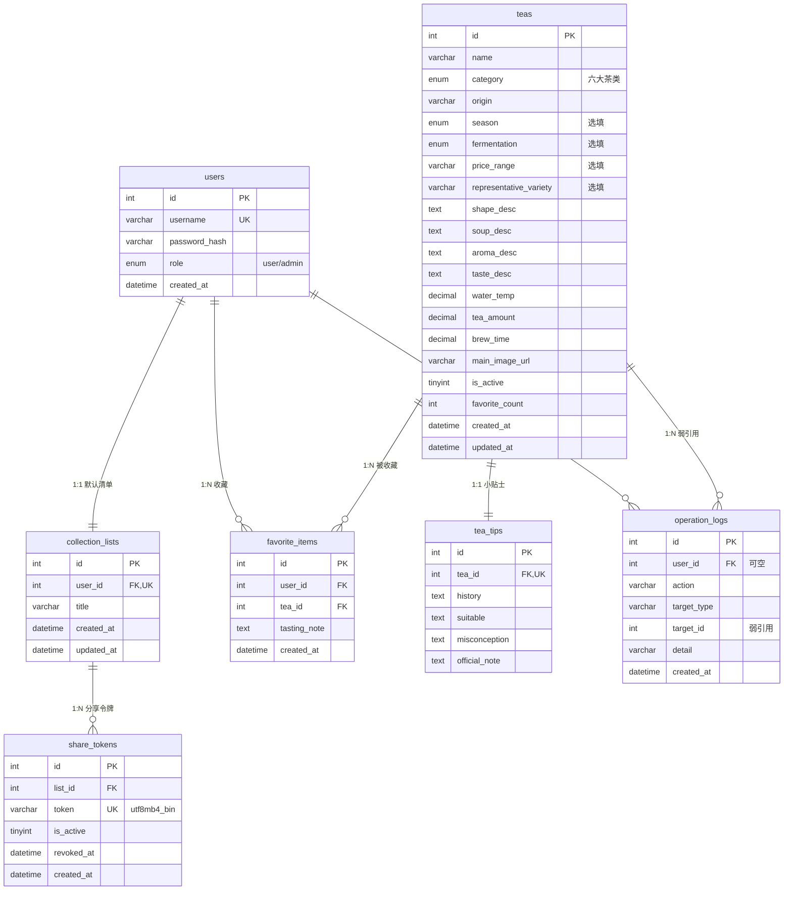

# 茶·图鉴 —— 数据模型设计文档（DATA_MODEL）

| 项 | 值 |
|---|---|
| 文档版本 | **v1.0（已确认）** |
| 创建日期 | 2026-11-06 |
| 修订记录 | v1.0（2026-11-06）：基于 PRD v1.1 与已确认技术架构完成数据模型定稿；确认 7 张表、清单独立建表、`share_tokens` 改挂 `list_id`、`operation_logs` 最小留痕、不建 `sessions` 表 |
| 分析依据 | [PRD.md](../product/PRD.md) v1.1 · [TECH_STACK.md](TECH_STACK.md) v1.0 · [ARCHITECTURE.md](ARCHITECTURE.md) · [MODULE_DESIGN.md](MODULE_DESIGN.md) · `backend/app/models/` |
| 配套脚本 | [database/init.sql](../../database/init.sql)（建库 + 建表 + 索引 + 种子数据） |
| 数据库基线 | MySQL **5.7.19+**，InnoDB，`utf8mb4` / `utf8mb4_unicode_ci` |
| 范围约束 | 仅 MVP（PRD §2.1）。S1–S17 第二阶段能力不建表；不建通知表、审核表、多清单结构、投稿表 |

---

## 1. 基线核查结论

### 1.1 脚手架已有 ORM 与规划表对照

| TECH_STACK §2.1 基线表 | 脚手架状态 | 最终结论 |
|---|---|---|
| `tea` → `teas` | ✅ 已实现 | 保留；枚举/精度/索引收敛（C5–C7） |
| `tea_tips` → `tea_tips` | ✅ **已实现**（与 `Tea` 同文件，1:1） | 保留，无结构变更 |
| `user` → `users` | ✅ 已实现 | 保留；`role` 改 ENUM（C8） |
| `favorite_item` → `favorite_items` | ✅ 已实现 | 保留；品鉴笔记已内置 |
| `tasting_note`（独立表） | ❌ 未建 | **确认不建**：PRD §4.2 中品鉴笔记是清单条目的属性；FR-5.7 明确"用户备注合并到品鉴笔记"；单清单 MVP 下拆表是 1:1 冗余 |
| `share_token` → `share_tokens` | ✅ 已实现 | 改造：`user_id` → `list_id`、移除 `title`、`token` 改大小写敏感（C1–C4） |
| `session` | ❌ 未建 | **确认不建**：HttpOnly 签名 Cookie（itsdangerous，30 天）已满足 FR-4.3；无服务端强制下线需求 |
| `operation_log` → `operation_logs` | ❌ 未建 | **补齐（最小表）**：MVP 无审核流程，管理员写操作需留痕 |
| —— | —— | **新增 `collection_lists`**：PRD §4.2 清单有可编辑标题、创建时间，必须持久化 |

**数量核对**：8 张基线表 − `tasting_note`（合并）+ `collection_lists`（PRD 实体）= **7 张**，未超出基线。

### 1.2 关键决策摘要

| 决策 | 结论 |
|---|---|
| 收藏清单 | 独立建表 `collection_lists`，`UNIQUE(user_id)` 固化 MVP 一人一清单 |
| 分享对象 | `share_tokens.list_id → collection_lists.id`（不再直接挂用户） |
| 分享标题 | 不存令牌上，动态读 `collection_lists.title`（消除双事实源） |
| 收藏计数 | `teas.favorite_count` 冗余计数，事务内维护 + 对账兜底 |
| 品鉴笔记 | 合并于 `favorite_items.tasting_note` |
| 会话 | 不建 `sessions`，签名 Cookie |
| 审计 | `operation_logs` 仅记录管理员写操作 |
| 删除策略 | 茶下架、分享撤销均为软失效，禁止物理删除 |

---

## 2. 表清单总览

| # | 表名 | 用途 | 预估行数 | 对应 PRD 模块 |
|---|---|---|---|---|
| 1 | `users` | 用户账号与角色 | < 1,000 | 模块 4（§4.3） |
| 2 | `teas` | 茶品图鉴卡片 | 30–50（初版） | 模块 1/2/3/6（§4.1） |
| 3 | `tea_tips` | 官方小贴士 4 区块 | ≈ `teas` | 模块 3/6（§4.1） |
| 4 | `collection_lists` | 用户默认清单 | ≈ `users` | 模块 5（§4.2） |
| 5 | `favorite_items` | 收藏条目 + 私有笔记 | < 5,000 | 模块 5（§4.2） |
| 6 | `share_tokens` | 分享令牌（有效/撤销） | < 1,000 | 模块 5（FR-5.4/5.5） |
| 7 | `operation_logs` | 管理员写操作留痕 | < 1,000/年 | 模块 6 |

---

## 3. ER 图

---

## 4. 逐表定义

### 4.1 `users` — 用户账号

- **业务用途**：PRD §3.1 角色、§4.3 用户字段；FR-4.1 注册、FR-4.2 登录、FR-4.3 会话保持。
- **字段**：

| 字段 | 类型 | NULL | 默认 | 约束/说明 |
|---|---|---|---|---|
| `id` | INT UNSIGNED | 否 | AUTO_INCREMENT | 主键 |
| `username` | VARCHAR(32) | 否 | — | 3–20 字符由 Pydantic 校验；唯一 |
| `password_hash` | VARCHAR(255) | 否 | — | bcrypt（60 字符），不存明文 |
| `role` | ENUM('user','admin') | 否 | 'user' | 权限矩阵依据 |
| `created_at` | DATETIME | 否 | CURRENT_TIMESTAMP | UTC |

- **主/外键**：PK `id`；无外键。
- **索引**：`uk_users_username`（唯一）→ 注册唯一性校验（FR-4.1）、登录按名查询（FR-4.2）。
- **状态枚举**：`role` = user / admin。
- **关系**：1:1 `collection_lists`；1:N `favorite_items`；1:N `share_tokens`（经清单）；1:N `operation_logs`。

### 4.2 `teas` — 茶品图鉴卡片

- **业务用途**：PRD §4.1 字段清单；FR-6.1 新增、FR-6.2 编辑、FR-6.3 上下架；FR-1.1~1.6 筛选/排序/分页；FR-2.x 首页热门与随机。
- **字段**：

| 字段 | 类型 | NULL | 默认 | 约束/说明 |
|---|---|---|---|---|
| `id` | INT UNSIGNED | 否 | AUTO_INCREMENT | 主键 |
| `name` | VARCHAR(100) | 否 | — | 不建唯一约束（允许同名不同产区） |
| `category` | ENUM('green','white','yellow','red','oolong','dark') | 否 | — | 六大茶类 |
| `origin` | VARCHAR(200) | 否 | — | "省 市 产区"；省级筛选用前缀匹配 |
| `season` | ENUM(6 值) | 是 | NULL | 明前/雨前/春茶/夏茶/秋茶/冬茶 |
| `fermentation` | ENUM(5 值) | 是 | NULL | 不发酵/微发酵/半发酵/全发酵/后发酵 |
| `price_range` | VARCHAR(32) | 是 | NULL | 5 档，文案未定稿 → 应用层校验 |
| `representative_variety` | VARCHAR(100) | 是 | NULL | 代表品类 |
| `shape_desc` / `soup_desc` / `aroma_desc` / `taste_desc` | TEXT | 否 | 应用写 `''` | 5.7 中 TEXT 不能有 DB 默认值 |
| `water_temp` | DECIMAL(4,1) | 是 | NULL | 70.0–100.0，应用校验 |
| `tea_amount` | DECIMAL(4,1) | 是 | NULL | 克 |
| `brew_time` | DECIMAL(4,1) | 是 | NULL | 秒 |
| `main_image_url` | VARCHAR(500) | 是 | NULL | PRD 必填，由 Pydantic 强制；DB 放宽避免种子/迁移阻塞 |
| `is_active` | TINYINT(1) | 否 | 1 | 1 上架 / 0 下架 |
| `favorite_count` | INT UNSIGNED | 否 | 0 | 冗余计数（§6.2） |
| `created_at` | DATETIME | 否 | CURRENT_TIMESTAMP | 最新上架排序依据 |
| `updated_at` | DATETIME | 否 | CURRENT_TIMESTAMP ON UPDATE | 编辑审计 |

- **主/外键**：PK `id`；无外键。
- **索引**：`idx_teas_active_category`(is_active, category)、`idx_teas_active_created`(is_active, created_at)、`idx_teas_active_favorite`(is_active, favorite_count)，见 §5。
- **状态枚举**：`is_active` 0/1；`category` 六值；`season`/`fermentation` 见上。
- **关系**：1:1 `tea_tips`；1:N `favorite_items`。

### 4.3 `tea_tips` — 官方小贴士

- **业务用途**：PRD §4.1 小贴士区 4 区块；FR-6.4 独立编辑/清空。
- **字段**：`id` INT UNSIGNED PK；`tea_id` INT UNSIGNED NOT NULL；`history` / `suitable` / `misconception` / `official_note` TEXT NULL。
- **主/外键**：PK `id`；FK `tea_id → teas.id`，`ON DELETE CASCADE ON UPDATE CASCADE`。理由：小贴士是茶的从属内容，脱离茶无意义；MVP 不物理删茶，级联仅作防御。
- **索引**：`uk_tea_tips_tea_id`（唯一 tea_id）→ 详情页 1:1 查询，同时固化 1:1 基数。
- **状态**：无；NULL 表示该区块未发布 → 前端隐藏。
- **关系**：1:1 `teas`。

### 4.4 `collection_lists` — 用户默认清单

- **业务用途**：PRD §4.2 清单标题/可见性/创建者/创建时间；FR-5.1 自动创建默认清单、标题可编辑；FR-5.2 清单页标题。
- **字段**：

| 字段 | 类型 | NULL | 默认 | 约束/说明 |
|---|---|---|---|---|
| `id` | INT UNSIGNED | 否 | AUTO_INCREMENT | 主键 |
| `user_id` | INT UNSIGNED | 否 | — | 一用户一清单 |
| `title` | VARCHAR(50) | 否 | '我的收藏' | 2–20 字由 Pydantic 校验 |
| `created_at` | DATETIME | 否 | CURRENT_TIMESTAMP | PRD §4.2 创建时间 |
| `updated_at` | DATETIME | 否 | CURRENT_TIMESTAMP ON UPDATE | 标题修改时间 |

- **主/外键**：PK `id`；FK `user_id → users.id`，`ON DELETE CASCADE`；`UNIQUE(user_id)`。
- **删除策略理由**：清单与用户 1:1 从属，删用户后清单无独立价值；MVP 不做用户删除（X8），级联为防御。
- **索引**：`uk_list_user`（唯一 user_id）→ 按用户取清单 / 首次自动创建，兼作单清单约束。
- **状态**：无独立状态列。PRD §4.2 的"可见性"**由 `share_tokens.is_active` 派生**（有生效令牌 = 链接可见），避免两处状态漂移。
- **关系**：1:1 `users`；1:N `share_tokens`；逻辑 1:N `favorite_items`（经 `user_id` 代理）。

### 4.5 `favorite_items` — 收藏条目 + 品鉴笔记

- **业务用途**：PRD §4.2 条目字段（备注/品鉴笔记/收藏时间）；FR-5.1 收藏与取消、FR-5.2 清单列表、FR-5.3 笔记独立存储、FR-5.6 一键收藏跳过。
- **字段**：

| 字段 | 类型 | NULL | 默认 | 约束/说明 |
|---|---|---|---|---|
| `id` | INT UNSIGNED | 否 | AUTO_INCREMENT | 主键 |
| `user_id` | INT UNSIGNED | 否 | — | 收藏人 |
| `tea_id` | INT UNSIGNED | 否 | — | 被收藏茶 |
| `tasting_note` | TEXT | 是 | NULL | 私有笔记，NULL = 未写 |
| `created_at` | DATETIME | 否 | CURRENT_TIMESTAMP | 收藏时间（FR-5.2 排序） |

- **主/外键**：PK `id`；FK `user_id → users.id` CASCADE；FK `tea_id → teas.id` CASCADE。理由：关联事实依赖双方存在；MVP 不物理删用户/茶，级联不触发。
- **索引**：`uk_favorite_user_tea`（唯一 user_id+tea_id）→ 防重复与状态查询；`idx_favorite_user_created`(user_id, created_at) → 清单按时间倒序；`idx_favorite_tea`(tea_id) → 外键级联与按茶重算。
- **状态**：无（行存在即已收藏）。
- **关系**：N:1 `users`；N:1 `teas`；即 `users` ↔ `teas` 的 N:N 关联表。
- **MVP 取舍**：不挂 `list_id`。一人一清单时 `user_id` 与清单一一对应，可省一次 join 与前置查询；S9 多清单时再补列并回填（有意延后，非遗漏）。

### 4.6 `share_tokens` — 分享令牌

- **业务用途**：FR-5.4 生成唯一 URL、FR-5.5 撤销、FR-5.6 访客一键收藏。
- **字段**：

| 字段 | 类型 | NULL | 默认 | 约束/说明 |
|---|---|---|---|---|
| `id` | INT UNSIGNED | 否 | AUTO_INCREMENT | 主键 |
| `list_id` | INT UNSIGNED | 否 | — | 分享对象为清单 |
| `token` | VARCHAR(16) COLLATE utf8mb4_bin | 否 | — | **大小写敏感**；唯一 |
| `is_active` | TINYINT(1) | 否 | 1 | 1 有效 / 0 已撤销 |
| `revoked_at` | DATETIME | 是 | NULL | 撤销时刻 |
| `created_at` | DATETIME | 否 | CURRENT_TIMESTAMP | 生成时刻 |

- **主/外键**：PK `id`；FK `list_id → collection_lists.id`，`ON DELETE CASCADE`。理由：令牌属于清单，清单不存在则无意义。
- **索引**：`uk_share_token`（唯一 token）→ `/c/{token}` 查询与撤销定位；`idx_share_list_active`(list_id, is_active) → 判断清单是否已有生效分享，兼作外键索引。
- **状态**：`is_active` + `revoked_at`；**无过期时间**（FR-5.4 明确"永久有效，除非显式撤销"）。
- **关系**：N:1 `collection_lists`；经清单得到所有者用户。

> **排序规则必须为二进制**：`utf8mb4_unicode_ci` 下 `k7X9m2` 与 `K7X9M2` 相等，等于允许大小写变体命中同一令牌，放大猜测面。`token` 使用 `utf8mb4_bin`。

### 4.7 `operation_logs` — 管理员操作留痕

- **业务用途**：模块 6（FR-6.1/6.2/6.3/6.4）写操作追溯；MVP 无审核流程下的唯一问责手段。
- **字段**（最小集）：

| 字段 | 类型 | NULL | 默认 | 约束/说明 |
|---|---|---|---|---|
| `id` | INT UNSIGNED | 否 | AUTO_INCREMENT | 主键 |
| `user_id` | INT UNSIGNED | 是 | NULL | 操作人；账号删除后置空 |
| `action` | VARCHAR(32) | 否 | — | create_tea / update_tea / toggle_tea / upload_image |
| `target_type` | VARCHAR(32) | 否 | 'tea' | MVP 仅 tea |
| `target_id` | INT UNSIGNED | 是 | NULL | 目标主键（弱引用） |
| `detail` | VARCHAR(500) | 是 | NULL | 摘要，不存 JSON diff |
| `created_at` | DATETIME | 否 | CURRENT_TIMESTAMP | |

- **主/外键**：PK `id`；FK `user_id → users.id`，`ON DELETE SET NULL`。理由：审计必须比账号活得久。
- **索引**：`idx_oplog_created`(created_at) → 后台"最近操作"倒序；`idx_oplog_user`(user_id) → 外键与按人过滤。
- **状态**：`action` 用 **VARCHAR 而非 ENUM**：日志应能接纳新动作而不做 DDL，历史日志不应受新枚举约束。
- **关系**：N:1 `users`；对 `teas` 弱引用（不建 FK，防止删茶抹日志）。
- **记录范围**：仅管理员写操作（POST/PUT/PATCH），不记 GET，不存整行快照。

---

## 5. 索引清单

| 索引名 | 表 | 字段 | 类型 | 服务的具体查询 |
|---|---|---|---|---|
| `uk_users_username` | users | username | 唯一 | 注册唯一性校验、登录按用户名 |
| `idx_teas_active_category` | teas | (is_active, category) | 普通 | 列表 `is_active=1 AND category IN(...)`；首页六大类计数 |
| `idx_teas_active_created` | teas | (is_active, created_at) | 普通 | 列表默认"最新上架"+分页 |
| `idx_teas_active_favorite` | teas | (is_active, favorite_count) | 普通 | 首页热门前 8、列表"收藏最多" |
| `uk_tea_tips_tea_id` | tea_tips | tea_id | 唯一 | 详情页 1:1 查询；固化 1:1 |
| `uk_favorite_user_tea` | favorite_items | (user_id, tea_id) | 唯一 | 防重复收藏、收藏状态 |
| `idx_favorite_user_created` | favorite_items | (user_id, created_at) | 普通 | 我的清单按收藏时间倒序 |
| `idx_favorite_tea` | favorite_items | tea_id | 普通 | 外键级联、按茶重算计数 |
| `uk_list_user` | collection_lists | user_id | 唯一 | 取用户清单、首次创建；固化单清单 |
| `uk_share_token` | share_tokens | token | 唯一 | `/c/{token}`、撤销定位 |
| `idx_share_list_active` | share_tokens | (list_id, is_active) | 普通 | 清单是否已有生效分享 |
| `idx_oplog_created` | operation_logs | created_at | 普通 | 后台最近操作倒序 |
| `idx_oplog_user` | operation_logs | user_id | 普通 | 外键；按操作人过滤 |

**明确不建的索引**：

| 候选 | 原因 |
|---|---|
| `teas.name` 单列 | 关键词搜索为 `LIKE '%词%'`，前置通配无法命中 B-tree；无按名等值查询 |
| `teas.category` / `is_active` / `favorite_count` 单列 | 均被组合索引最左前缀覆盖 |
| `teas.origin` | 数据量 30–50 行，前缀筛选用全表扫描成本更低 |
| `teas.season` / `fermentation` / `price_range` | 与其他维度任意 AND 组合，单列索引无法覆盖；低基数 |
| `favorite_items.tasting_note` | 不参与检索 |
| `share_tokens.user_id` | 已改为 `list_id`（C1） |
| `operation_logs.target_id` | MVP 不提供按茶查历史，仅弱引用存储 |

---

## 6. 关键机制

### 6.1 单清单与收藏数量

- 一个用户 **1 个清单**（MVP）、**收藏数不设上限**（实际上限 = 在架茶品数）。
- 单清单采用**双保险**：
  - DB：`UNIQUE(collection_lists.user_id)` 是硬约束，并发"首次创建"只有一次成功；
  - 服务层：`get_or_create` 幂等创建默认清单，唯一冲突转为"已存在"而非 500。
- 只靠任一方都有缺口：无索引会并发双写；无服务层则首次访问直接抛 409。

### 6.2 收藏计数（`teas.favorite_count`）

- 采用**冗余计数**，不在列表页实时 COUNT：
  - 卡片 ❤️ N 需逐条聚合；"收藏最多"要求聚合值参与排序；MySQL 5.7 无窗口函数，只能子查询/临时表，代价更高；
  - 冗余列可直接走 `(is_active, favorite_count)` 索引取前 N 条。
- 一致性维护：
  1. 收藏/取消与计数变更**同事务**；新增 +1，删除 −1，递减做下限保护；
  2. 唯一索引保证重复点击不重复计数；
  3. 提供**对账重算**能力（按 `favorite_items` 分组重算），作为运维脚本/后台命令，**不进请求链路**。

### 6.3 防重复收藏与一键收藏

- 硬约束 `UNIQUE(user_id, tea_id)`；并发下只有一个写入成功。
- 单条：服务层先查状态决定 toggle 方向，写入撞唯一冲突时按"已存在"幂等处理。
- 一键收藏（FR-5.6）：取分享清单在架茶品 → 查当前用户已收藏集合 → **求差集 → 批量插入 → 只对差集计数 +N** → 返回 `added` / `skipped`。
- 不使用 `INSERT IGNORE`：它会把外键缺失等错误一并降级为警告。先差集 + 唯一索引兜底最清晰。
- 所有者不得一键收藏自己的清单（服务层按 `list.user_id != current_user.id` 判断）。

### 6.4 软失效与分享令牌

- 茶下架：`teas.is_active = 0`；分享撤销：`share_tokens.is_active = 0` + `revoked_at`。**均不物理删除**。
- 原因：
  1. 物理删茶会经外键级联删除用户收藏与笔记，违反 FR-6.3"清单内保留灰显占位"；
  2. 已分发的分享链接需要"已撤销"的明确语义，而不是 404；
  3. 撤销/下架时间本身是运营事实，需可追溯；
  4. 保持引用完整性，查询侧用 `is_active` 过滤即可。
- 令牌规则：
  - 生成：若清单已有 `is_active=1` 的令牌则**复用**，避免重复点击产生垃圾令牌；否则新建；
  - 撤销：只改状态，行保留；
  - **撤销后不可复活**：再次分享必须新建 token。旧链接可能已被转发/缓存，复活等于在所有者不知情时恢复访问权限；PRD FR-5.5 亦明确"撤销不可逆"。

### 6.5 审计留痕

- 仅记录管理员写操作，每次 1 行 INSERT；不记录读操作。
- `user_id` 采用 `SET NULL`，`target_id` 不建外键：审计必须独立于业务实体生命周期。

---

## 7. 设计说明

### 7.1 枚举选型（为什么不建字典表）

| 字段 | 选型 | 理由 |
|---|---|---|
| `teas.category` | ENUM(6) | PRD §2.4 把六大茶类定为产品契约，无后台增删诉求 |
| `teas.season` | ENUM(6) | PRD §4.1 明确 6 值 |
| `teas.fermentation` | ENUM(5) | PRD §4.1 明确 5 值 |
| `teas.price_range` | VARCHAR(32) + Pydantic 校验 | PRD 只说"5 档"，档位文案/边界未定稿，ENUM 会把内容固化成 DDL |
| `users.role` | ENUM(2) | 权限矩阵按角色 |
| `operation_logs.action` | VARCHAR(32) | 日志需可扩展动作，历史不受新枚举约束 |

**不建"茶类字典表"的理由**：
1. 六大茶类是**不变的产品契约**，字典表的核心价值（后台可维护选项）不存在；
2. 需要额外 join、CRUD 界面与缓存，而展示名/颜色本来就由前端 token 控制，字典表无法替代；
3. 会突破 TECH_STACK §2.1 的 8 张表基线（新增 PRD 没有的业务表）；
4. MySQL 5.7 无有效 CHECK，ENUM 是**唯一能落地的 DB 级枚举约束**；字典表仍需应用层校验，并不更强；
5. 代价（如实承认）：ENUM 加值需 DDL，但上述集合预期变更频率≈0；价格档位已用 VARCHAR 规避。

### 7.2 MySQL 5.7 注意点

| 注意点 | 处理 |
|---|---|
| **CHECK 约束被静默忽略**（8.0.16 前） | 枚举用 ENUM；数值范围（水温 70–100）、长度（用户名 3–20、标题 2–20）全部由 Pydantic/服务层校验；不用触发器 |
| **字符集/排序规则** | 库级 `utf8mb4` + `utf8mb4_unicode_ci`，所有表继承；禁用 `utf8`（3 字节，emoji 截断）。**例外**：`share_tokens.token` 用 `utf8mb4_bin` |
| **VARCHAR 按字符计** | 索引字节上限 COMPACT 767 / DYNAMIC 3072；本项目最长被索引列为 32 字符，安全 |
| **TEXT 不能有 DEFAULT** | 四个感官描述与 `tasting_note` 无 DB 默认，空串由应用写入 |
| **DATETIME vs TIMESTAMP** | 统一 DATETIME：无 2038 限制、无会话时区隐式转换；TIMESTAMP 会与 UTC 写入叠加造成双重转换 |
| **数值精度** | 三个冲泡参考值用 DECIMAL(4,1)，避免 FLOAT 的二进制近似导致的展示误差 |
| **主键/引擎** | INT UNSIGNED AUTO_INCREMENT；InnoDB（事务、外键、行锁） |
| **JSON** | 5.7 支持，但 MVP 不需要；`detail` 用 VARCHAR 摘要，避免把文档字段当结构用 |
| **大小写** | `username` 大小写不敏感（uni_ci）是期望行为（"TeaFan" ≡ "teafan"）；`token` 必须敏感 |

### 7.3 时间字段策略

| 项 | 约定 |
|---|---|
| 存储 | 全部 `DATETIME`，**统一 UTC** |
| 写入 | 应用层 `datetime.utcnow()`；DB `DEFAULT CURRENT_TIMESTAMP` 仅兜底，部署时 MySQL `time_zone` 需为 `+00:00` |
| 展示 | API 输出 ISO8601（带 `Z`），前端按 `Asia/Shanghai` 渲染；后端不做本地时区换算 |
| 会话 30 天 | 由 Cookie `max_age` 控制，不落库 |
| 精度 | 秒级 `DATETIME(0)`；同秒并列按 `id` 次级排序 |

### 7.4 命名约定

- 表名**复数 + snake_case**：`users` / `teas` / `tea_tips` / `collection_lists` / `favorite_items` / `share_tokens` / `operation_logs`。
- 外键列：`{单数表名}_id`（`user_id` / `tea_id` / `list_id`）。
- 索引：唯一 `uk_{表}_{语义}`、普通 `idx_{表}_{语义}`。
- SQLAlchemy 2.0：`Mapped[...]` + `mapped_column(...)`；枚举 `Enum(..., name=...)`；定点数 `Numeric(4,1)`；`DateTime` 不带 `timezone=True`。

---

## 8. 已落地的模型变更

| # | 对象 | 变更 | 影响面 |
|---|---|---|---|
| C1 | `share_tokens` | `user_id` → `list_id`（FK → `collection_lists.id`，CASCADE） | 模型 + 分享生成/撤销/查看服务；**API 契约不变**（对外仍按登录用户鉴权） |
| C2 | `share_tokens` | 移除 `title`，改为读 `collection_lists.title` | 分享查看服务；`POST /shares/generate` 不再接收 title |
| C3 | `share_tokens` | `token` VARCHAR(32) → VARCHAR(16)，`utf8mb4_bin` | 模型列定义；不改 token 算法 |
| C4 | `share_tokens` | 新增 `idx_share_list_active` | 仅索引 |
| C5 | `teas` | `season` / `fermentation` 改 ENUM | 空库迁移，无风险 |
| C6 | `teas` | 三个冲泡数值 Float → DECIMAL(4,1) | 空库迁移 |
| C7 | `teas` | 索引收敛为 3 条组合索引，移除 4 条单列索引 | 仅索引 |
| C8 | `users` | `role` 改 ENUM('user','admin') | 空库迁移 |
| C9 | 新增模型 | `CollectionList`、`OperationLog` 并注册到 `models/__init__.py` | 新增表 |
| C10 | `favorite_items` | 结构不变（保留 `user_id` + `tasting_note`） | 无 |
| C11 | `tea_tips` | 不变 | 无 |
| C12 | `users` | 不新增 `level` | 无（S15 第二阶段） |

**注意**：`share_tokens` 与 `favorite_items` 的所有者关系不同——分享挂 `list_id`，收藏挂 `user_id`。前者因分享是"清单"的外部能力；后者因 MVP 单清单可用 `user_id` 代理，减少一次 join。二者并非不一致，而是有意取舍。

---

## 9. 种子数据说明（`database/init.sql`）

| 内容 | 数量 | 说明 |
|---|---|---|
| 管理员账号 | 1 | `admin` / `admin123`（bcrypt cost=10）。**上线前必须修改密码** |
| 示例茶品 | 6 | 六大茶类各一款，字段完整，主图使用外链 CDN |
| 官方小贴士 | 6 组 | 按 FR-6.4，未写的区块留 NULL 供前端隐藏 |
| 清单 / 收藏 / 令牌 / 日志 | 0 | 由运行时行为产生；默认清单在用户首次访问时自动创建 |

> `teas.favorite_count` 种子值为**演示热度**（取自原型 mock），与 `favorite_items` 实际行数不相等。正式环境可由对账重算归零，或在后台维护时逐步校准。这是有意的演示数据取舍，不是约束缺陷。

---

## 10. 扩展预留（第二阶段，不建表）

| 能力 | 预留位置 | 说明 |
|---|---|---|
| S9 多清单 | `collection_lists` 去掉 `UNIQUE(user_id)`，`favorite_items` 增补 `list_id` 并回填 | 现有 4 列结构可直接演进 |
| S10/S11 用户投稿 | 新建 `tea_submissions`（表外），`teas` 增 `source`/`created_by` | 不动现有表语义 |
| S12 管理员审核 | 新建审核队列表，或 `tea_submissions` 加状态机 | 不与 `operation_logs` 混用 |
| S7 小贴士预览 / 富文本 | `tea_tips` 文本列扩展为富文本存储 | 列类型不变 |
| 等级 S15 | `users` 增 `level` 列 | MVP 不建 |

---

## 11. 变更记录

| 版本 | 日期 | 内容 |
|---|---|---|
| v0.1（方案稿） | 2026-11-06 | 基线核查 + 7 表方案 + 5 条重点检查 + 12 项待确认 |
| **v1.0** | 2026-11-06 | 确认全部推荐项；产出 `init.sql`；同步 ORM 模型与 ARCHITECTURE / MODULE_DESIGN |
